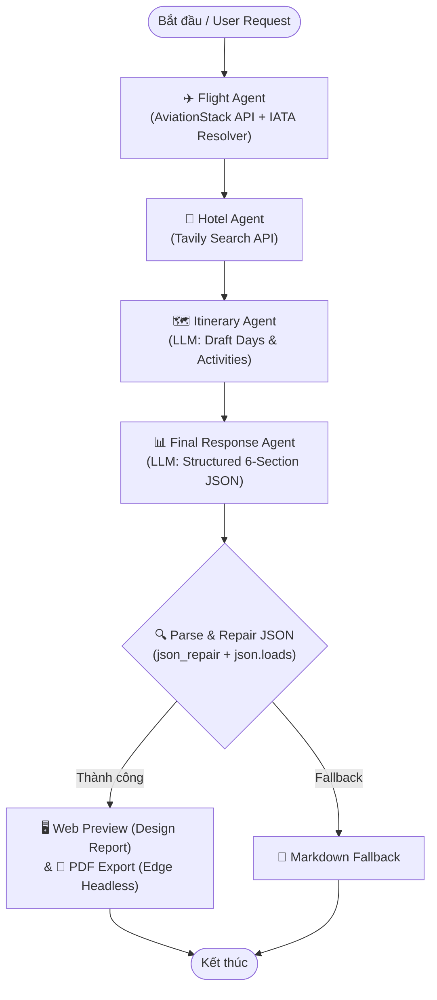

# TripMate AI — Multi-Agent Architecture & Specifications

Tài liệu này mô tả chi tiết kiến trúc hệ thống **Multi-Agent** của TripMate AI được xây dựng dựa trên framework **LangGraph**, các vai trò (roles), công cụ (tools), cấu trúc trạng thái (state), quy trình phối hợp và cơ chế xử lý lỗi của từng Agent.

---

## 1. Tổng quan kiến trúc (Architectural Overview)

TripMate AI áp dụng mô hình luồng làm việc đồ thị trạng thái tuần tự (**Sequential StateGraph**) kết hợp với hệ thống lưu trữ trạng thái phiên làm việc (**PostgreSQL Checkpointer**). 

Mỗi Agent đảm nhận một chuyên môn hẹp trong chuỗi giá trị lập kế hoạch du lịch:
1. Thu thập dữ liệu chuyến bay trực tiếp (`flight_agent`)
2. Tìm kiếm thông tin khách sạn và giá phòng (`hotel_agent`)
3. Lập khung sườn lịch trình ngày-theo-ngày (`itinerary_agent`)
4. Tổng hợp, chuẩn hóa và xuất dữ liệu JSON có cấu trúc 6 phần chuyên nghiệp (`final_agent`)



---

## 2. Trạng thái dùng chung (Shared State: `TravelState`)

Toàn bộ các Agent chia sẻ và tích lũy thông tin qua `TravelState`:

```python
class TravelState(TypedDict):
    messages: Annotated[list[AnyMessage], operator.add]  # Lịch sử hội thoại tích lũy
    user_query: str                                     # Câu truy vấn gốc của người dùng
    flight_results: str                                 # Dữ liệu chuyến bay từ flight_agent
    hotel_results: str                                  # Dữ liệu khách sạn từ hotel_agent
    itinerary: str                                      # Bản thảo lịch trình từ itinerary_agent
    llm_calls: int                                      # Số lượt gọi LLM trong toàn chu trình
```

- **Tính bất biến & tích lũy:** Khóa `messages` sử dụng reducer `operator.add` giúp lưu giữ đầy đủ vết thực thi của từng Agent dưới dạng `AIMessage`.
- **Phân tách phiên làm việc (Session Isolation):** Được điều khiển bởi cấu hình `configurable: {"thread_id": "<user_thread_id>"}` thông qua `PostgresSaver`.

---

## 3. Đặc tả chi tiết từng Agent

### 3.1. Flight Agent (`flight_agent`)

- **Vai trò:** Trích xuất điểm đi, điểm đến, ngày bay từ yêu cầu tự nhiên của người dùng và tra cứu dữ liệu chuyến bay thời gian thực.
- **Công cụ sử dụng:**
  - `tools.flight_tool.search_flights(query)`
  - Dữ liệu mã sân bay: `airportsdata` (tập dữ liệu IATA toàn cầu).
  - Chuẩn hóa quốc gia: `pycountry` và bảng ánh xạ alias `COUNTRY_ALIASES`.
  - API ngoài: **AviationStack API** (`BASE_URL = "https://api.aviationstack.com/v1/flights"`).
- **Cơ chế phân tích tuyến bay (`parse_route`):**
  1. Nhận diện các câu truy vấn toàn cầu (ví dụ: *"all flights"*).
  2. Bắt cặp mã IATA viết hoa trực tiếp (ví dụ: `SGN to BKK`).
  3. Nhận diện mẫu ngữ pháp tự nhiên: `from [X] to [Y]` hoặc `to [Y] from [X]`.
  4. Tự động gán điểm đi mặc định (`DEFAULT_ORIGIN_IATA = "HAN"` hoặc `"SGN"`) khi người dùng chỉ nêu điểm đến (ví dụ: *"Du lịch Thái Lan 5 ngày"*).
- **Đầu ra:** Cập nhật trường `flight_results` chứa danh sách các chuyến bay (Hãng bay, Số hiệu, Sân bay đi/đến, Giờ bay dự kiến, Trạng thái hoãn/đúng giờ).

---

### 3.2. Hotel Agent (`hotel_agent`)

- **Vai trò:** Tìm kiếm thông tin khách sạn, đánh giá dịch vụ, mức giá tham khảo và khu vực lưu trú phù hợp với điểm đến và ngân sách.
- **Công cụ sử dụng:**
  - `tools.tavily_tool.tavily_search(query)`
  - API ngoài: **Tavily Search API**.
- **Chiến lược tối ưu Token (Token Optimization):**
  - Xây dựng câu truy vấn tập trung: `f"Best hotels for {state['user_query']}"`.
  - Giới hạn số lượng kết quả (`max_results = 5`).
  - Cắt ngắn đoạn trích (snippet) ở mức tối đa **300 ký tự** để ngăn chặn việc gây tràn ngữ cảnh cho các agent phía sau.
- **Đầu ra:** Cập nhật trường `hotel_results` chứa danh sách 3–5 khách sạn tiêu biểu kèm link tham khảo và tóm tắt ưu điểm.

---

### 3.3. Itinerary Agent (`itinerary_agent`)

- **Vai trò:** Đóng vai trò là một chuyên gia thiết kế tour, tổng hợp nhu cầu người dùng cùng thông tin chuyến bay và khách sạn để phác thảo lịch trình hoạt động ngày-qua-ngày.
- **Mô hình sử dụng:** Groq API với mô hình `openai/gpt-oss-120b`, `max_tokens = 8192`.
- **Cơ chế hoạt động:**
  - Nhận đầu vào là `user_query`, `flight_results` (giới hạn 2.500 ký tự) và `hotel_results` (giới hạn 2.500 ký tự).
  - Xây dựng bản thảo chi tiết gồm: Buổi sáng, Buổi trưa, Buổi chiều, Buổi tối, kèm các điểm ăn uống và tham quan đặc sắc.
- **Đầu ra:** Cập nhật trường `itinerary` làm tiền đề dữ liệu hoàn chỉnh cho Agent xuất bản cuối cùng.

---

### 3.4. Final Response Agent (`final_agent`)

- **Vai trò:** Agent tổng hợp tối cao, có nhiệm vụ biên tập toàn bộ dữ liệu thành một đối tượng JSON cấu trúc chuẩn mực tuân thủ hợp đồng mẫu thiết kế báo cáo du lịch.
- **Quy ước Hợp đồng Dữ liệu (`PLAN_JSON_INSTRUCTIONS`):**
  Mô hình được chỉ thị xuất **duy nhất một đối tượng JSON** (không chứa markdown fences, không có lời chào) gồm 6 phần tương đương với [`ke-hoach-thai-lan-5-ngay.pdf`](file:///E:/Project/TripMateAI/ke-hoach-thai-lan-5-ngay.pdf):
  1. `destination`, `origin`, `dates`, `duration`, `travelers`, `budget_label`, `style`: Thông tin bìa và chips.
  2. `summary_cards`: Đúng 6 thẻ tóm tắt (*Điểm đến, Bay, Ở, Ăn & chơi, Tổng ước tính [thẻ vàng], Thời điểm đẹp nhất*) và `summary_note`.
  3. `flights`: Danh sách hãng bay, chặng, giờ bay, giá, ghi chú và huy hiệu (`highlight: "Rẻ nhất" | "Thoải mái nhất"`), kèm `flight_note` và `visa_note`.
  4. `hotels`: Danh sách khách sạn, khu vực, giá/đêm, ưu điểm và huy hiệu (`highlight: "Tiết kiệm" | "Đáng tiền"`), kèm `hotel_note`.
  5. `days`: Lịch trình từng ngày với `title`, `subtitle`, `date` và mảng `items` gồm `time`, `activity` (in đậm điểm tham quan chính), `cost`.
  6. `budget`: Bảng dự toán phân rã ngân sách chi tiết với các số tiền nguyên `amount` và chuỗi định dạng `label`, `total_amount`, `total_label`, `limit_amount`, `remaining_label`.
  7. `tips`: 6 thẻ lưu ý thực tế (*Tiền tệ, SIM & mạng, Đi lại, Phong tục/vào chùa, Đặt trước, Ứng dụng*).
  8. `disclaimer`: Miễn trừ trách nhiệm về biến động giá vé theo thời điểm thực tế.

- **Quản lý Token & Prompt Fallback:**
  - Tầng 1: Sử dụng prompt schema đầy đủ với dung lượng ngữ cảnh ~2.500 tokens.
  - Tầng 2: Nếu gặp lỗi 413 (Request Too Large), tự động chuyển sang schema tối giản (`minimal_instructions`) với ngữ cảnh thu gọn ~1.200 tokens.
- **Bộ lọc và tự phục hồi JSON (`parse_plan_json`):**
  - Trích xuất chuỗi JSON từ phản hồi LLM.
  - Thử phân tích cú pháp chuẩn bằng `json.loads`.
  - Tự động gọi thư viện `json_repair` để đóng các dấu ngoặc hoặc sửa lỗi dấu phẩy thừa khi mô hình phản hồi gặp sự cố, đảm bảo trường `plan` luôn hợp lệ.

---

## 4. Trình xuất bản báo cáo (Report & PDF Export Engine)

Khi `final_agent` hoàn tất và sinh ra cấu trúc `plan`:

1. **Hiển thị trực tiếp trên Web ([`static/script.js`](file:///E:/Project/TripMateAI/static/script.js)):**
   - Hàm `renderPlanReport(plan)` biên dịch JSON thành cấu trúc HTML/CSS với lớp `.rp-*`.
   - Kết quả hiển thị ngay trước mắt người dùng với giao diện đồng nhất: dải màu gradient, bảng dữ liệu thanh lịch, thanh phân bổ ngân sách theo phần trăm.
2. **Xuất PDF Vector Chất lượng cao ([`report_template.py`](file:///E:/Project/TripMateAI/report_template.py)):**
   - Hàm `render_plan_pdf(plan)` quét tìm binary của trình duyệt gốc hệ thống (Microsoft Edge hoặc Google Chrome).
   - Gọi lệnh headless native:
     ```powershell
     msedge --headless=new --disable-gpu --no-pdf-header-footer --print-to-pdf=output.pdf input.html
     ```
   - Tạo ra file PDF văn bản (vector text PDF, có thể chọn và copy chữ), kích thước gọn nhẹ, màu sắc chuẩn xác và hỗ trợ ngắt trang thông minh tránh cắt ngang các hàng hay thẻ chỉ dẫn.

---

## 5. Bảng tổng hợp công cụ và tài nguyên của các Agent

| Agent | Module / Tệp | Mô hình / Công cụ chính | Khóa State ghi nhận |
| :--- | :--- | :--- | :--- |
| **Flight Agent** | [`tools/flight_tool.py`](file:///E:/Project/TripMateAI/tools/flight_tool.py) | AviationStack API, AirportsData, PyCountry | `flight_results`, `messages` |
| **Hotel Agent** | [`tools/tavily_tool.py`](file:///E:/Project/TripMateAI/tools/tavily_tool.py) | Tavily Search API | `hotel_results`, `messages` |
| **Itinerary Agent** | [`backend.py`](file:///E:/Project/TripMateAI/backend.py) | Groq `openai/gpt-oss-120b` | `itinerary`, `messages`, `llm_calls` |
| **Final Agent** | [`backend.py`](file:///E:/Project/TripMateAI/backend.py) | Groq `openai/gpt-oss-120b`, `json_repair` | `messages`, `plan` |
| **Report Engine** | [`report_template.py`](file:///E:/Project/TripMateAI/report_template.py) | Edge/Chromium Headless CLI, WeasyPrint fallback | Xuất HTML và luồng PDF bytes |
